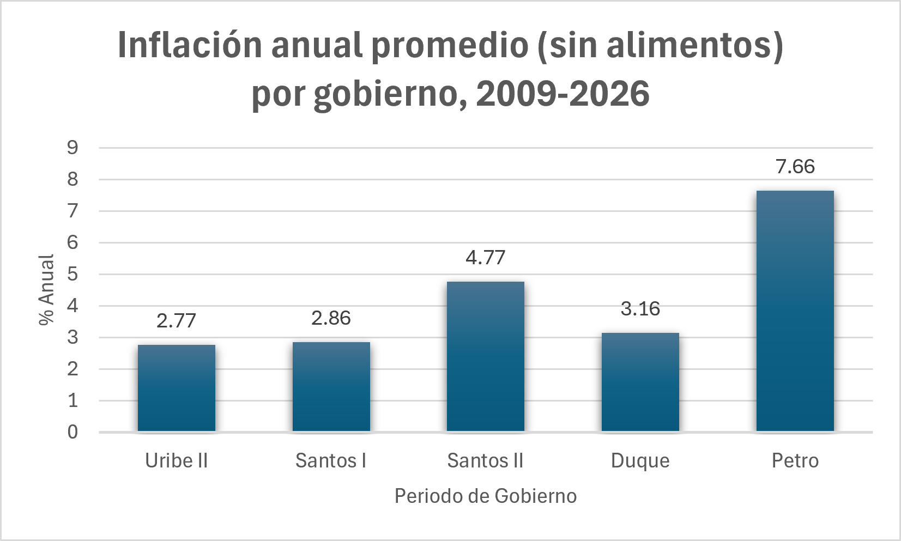

# Inflación en Colombia con SQL (IPC, DANE)

## Pregunta
¿Qué gobierno tuvo la mayor inflación anual promedio entre 2009 y 2026, y qué tan comparable es esa cifra entre gobiernos?

## Datos
- Fuente: [DANE, anexo del IPC, agosto 2026](https://www.dane.gov.co/index.php/estadisticas-por-tema/precios-y-costos/indice-de-precios-al-consumidor-ipc/ipc-historico#indice-de-precios-al-consumidor-ipc-2026)

## Limpieza
El anexo del DANE viene en un Excel con varias hojas y tablas lado a lado, así que lo preparé antes de cargarlo a SQL:

- **Power Query (Excel):** conservé las tablas que necesitaba, pasé la hoja de ciudades de formato ancho a largo (Unpivot) y junté las hojas de series mensuales en una sola tabla.
- **Fechas:** guardé `periodo` como texto `AAAA-MM`, porque al exportar a CSV Excel confunde día y mes, y el texto se ordena bien y sirve con `BETWEEN`.
- **Tipos de datos:** `var_anual` entró a SQLite como texto y daba máximos incorrectos. La corregí a número (REAL).
- **Vacíos:** las series no tienen variación anual en los primeros 12 meses (84 valores nulos); los promedios los ignoran.
- **Nombres de columnas:** sin tildes ni ñ.

## Herramientas
Excel (Power Query), SQLite, DB Browser for SQLite.

## Hallazgos

Usando la serie de inflación sin alimentos (no la inflación total), el gobierno de Gustavo Petro registra la inflación anual promedio más alta: 7.66%, más del doble que la de Duque (3.16%). Le sigue Santos II con 4.77%. La más baja corresponde a Uribe II (2.77%), pero ese valor usa solo 7 meses de datos frente a 48 en los demás gobiernos, así que no es plenamente comparable. Estas cifras no demuestran que la inflación se deba a la gestión de cada gobierno: factores externos, como el choque global de 2022-2023, pudieron influir y este análisis no permite medir su peso.

## Límites
- Uribe II solo tiene 7 meses de datos (los últimos de su mandato), así que su promedio no es comparable con el de los demás gobiernos (48 meses).
- Se usó la serie "sin alimentos" porque la tabla de series no incluye la inflación total; por eso las cifras pueden diferir de la inflación oficial.
- Un promedio por gobierno no demuestra que el gobierno haya causado esa inflación.

## Cómo reproducirlo
Las consultas están en `consultas_inflacion.sql`, pensadas para correr una a la vez en DB Browser for SQLite sobre una base con las tablas del IPC (limpiadas con Power Query a partir del anexo del DANE). Cada consulta lleva comentado el resultado esperado.
